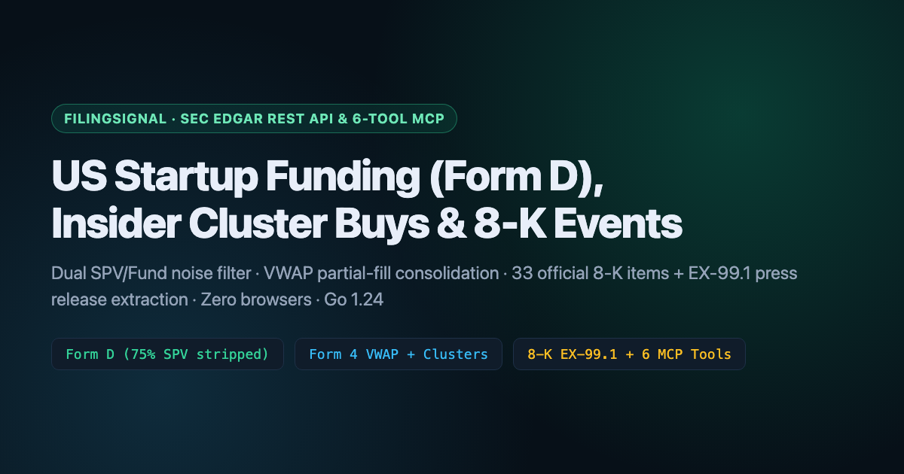

# FilingSignal — SEC Form D Startup Funding, Form 4 Insider Cluster Buys & 8-K Events (REST API & 6-Tool MCP)

[](https://glama.ai/mcp/servers/yun87457-web/sec-edgar-funding-insider-mcp)
[](https://glama.ai/mcp/connectors/io.github.yun87457-web/sec-edgar-funding-insider-mcp)
[](https://mcpservers.org/servers/yun87457-web/sec-edgar-funding-insider-mcp)

Official SEC EDGAR XML/JSON extraction in pure Go — zero headless browsers, zero Cloudflare challenges, zero proxies. Built as an API-first alternative to paywalled Crunchbase/OpenInsider workflows.

## Live Interactive SEC Intelligence Explorer (Nov 2026 Open Dataset)

Explore our live snapshot of **33 SPV-filtered US startup Form D rounds**, **47 VWAP-consolidated Form 4 trades**, **3 multi-insider cluster buys**, and **30 Form 8-K catalysts** (MIT open CSV/JSON):
- **Interactive Web Explorer:** https://yun87457-web.github.io/sec-edgar-funding-insider-mcp/
- **Open Downloads:** [`form-d-startups-nov-2026.csv`](./benchmarks/form-d-startups-nov-2026.csv) · [`form-4-insiders-nov-2026.csv`](./benchmarks/form-4-insiders-nov-2026.csv) · [`form-8k-events-nov-2026.csv`](./benchmarks/form-8k-events-nov-2026.csv)

## Access Channels

- **Apify Store (Batch + Standby + 3,333 Free Filings/mo):** https://apify.com/spiky_closet/sec-funding-insider-mcp
- **Official MCP Registry:** `io.github.yun87457-web/sec-edgar-funding-insider-mcp`
- **Hosted Streamable HTTP MCP:** `https://spiky-closet--sec-funding-insider-mcp.apify.actor/mcp`

## Install & Run Locally (Zero-Dependency 6-Tool Stdio MCP Server)

```bash
npx -y github:yun87457-web/sec-edgar-funding-insider-mcp
```

```json
{
  "mcpServers": {
    "filingsignal-sec": {
      "command": "npx",
      "args": ["-y", "github:yun87457-web/sec-edgar-funding-insider-mcp"],
      "env": { "APIFY_TOKEN": "YOUR_FREE_APIFY_TOKEN" }
    }
  }
}
```

## 6 Built-In MCP Tools

| Tool | What It Solves |
|---|---|
| `search_startup_funding` | US startup Form D rounds with dual SPV/fund exclusion (~75% EDGAR noise stripped) & Clay-ready executive/HQ columns |
| `search_insider_trades` | Open-market Form 4 buys/sells with exact share-weighted VWAP partial-fill consolidation, `% holdings Δ`, 10b5-1 & OTC kill-switches |
| `find_insider_cluster_buys` | Multi-insider cluster buys (`2+` distinct executives/directors) with joint-filer dedup & concurrent-sale guards |
| `search_corporate_events` | All 33 official SEC 8-K item codes + automatic `EX-99.1` press release discovery & clean text extraction |
| `get_company_sec_dossier` | Single-call public company CIK, exchange, recent 8-K catalysts & consolidated Form 4 trades |
| `get_filing_document` | On-demand clean-text retrieval of any primary filing or `EX-99.1`/`EX-10.1` exhibit with token-budget clamping |

## No-Code Integrations

- **Clay HTTP Enrichment:** [`integrations/clay-http-enrichment.json`](./integrations/clay-http-enrichment.json)
- **n8n Community Node Scaffold:** [`n8n-community-node/package.json`](./n8n-community-node/package.json)
